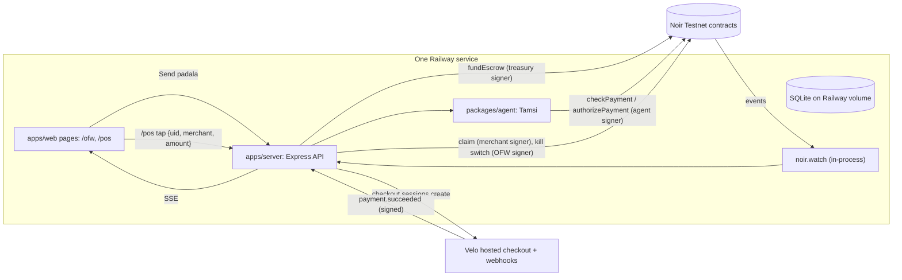
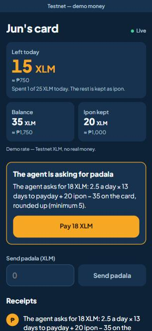
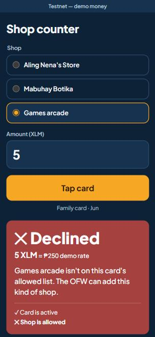

# Tamsi

An AI agent that spends an OFW's padala for the family one card tap at a time — only at shops the OFW allows, under a daily limit, always keeping savings — and shows the OFW every receipt.

**Live website:** https://tamsi-production.up.railway.app
**Demo video (2 min):** https://TODO
**Team:** Jersylle Hannah B. Nismal (Discord: jersy00053) — solo

Testnet only: this is Testnet XLM, no real money. The peso figures use a mock demo rate, and peso cash-out isn't built.

## Problem
Overseas Filipino workers send money home every month, but once it lands they can't see or guide how it's spent. Asking for receipts feels like distrust, so few people do, and savings quietly run out.

## Solution
The OFW owns a Noir tap card for a family member and funds it through a Velo checkout. Every tap goes to the Tamsi agent, which decides whether to pay: is this shop allowed, is it under today's limit, does it keep the savings floor? It pays the merchant through the Noir contracts, explains every decision, streams receipts to the OFW, and asks the OFW for a top-up — with an amount it worked out — when money runs low.

Noir's on-chain policy has a per-tap maximum and an expiry. It has no daily total and no merchant allowlist, so the agent adds those off-chain, without touching Noir's contracts.

## How the agentic payment works
1. A family member taps the card at a shop, and the shop's counter page sends the tap to our server.
2. The Tamsi agent checks, in order: card active → merchant category allowed → under daily cap → savings floor kept → Noir `checkPayment`. Taps on one card run one at a time, so two fast taps can't both pass the daily cap.
3. If every check passes, the agent signs `authorizePayment` with its constrained Noir key, paying the merchant from the card's escrow. Otherwise it declines with a reason code and one plain sentence. The decision is deterministic code; no LLM is involved.
4. When the savings floor stops a tap, or a payment leaves under about two days of average spending, the agent computes `avg daily spend × days to next payday + savings floor − balance` and opens a Velo checkout for that amount on the OFW's dashboard, with the formula filled in.
5. Merchants collect their pending balance with `claim`.
6. The OFW can turn the card off: revoke the agent, then withdraw the full balance. The next tap is refused by Noir's own check (`no_agent`).

## Architecture


## Noir integration
- SDK: `@noirx402/agent-sdk` 0.3.0
- Contracts: `device_registry`, `agent_registry`, `payment_escrow` (the SDK's built-in `TESTNET`, Oct 24 deploy). No contract IDs in this repo, and no contracts deployed by us.
- Methods and files:
  - `execute(registerDevice)`, `execute(registerAgent)` — [scripts/setup.ts#L96](https://github.com/jersy26/tamsi/blob/main/scripts/setup.ts#L96), [#L105](https://github.com/jersy26/tamsi/blob/main/scripts/setup.ts#L105)
  - `execute(fundEscrow)` (treasury, after a verified Velo payment) — [apps/server/src/index.ts#L42](https://github.com/jersy26/tamsi/blob/main/apps/server/src/index.ts#L42)
  - `checkPayment`, `authorizePayment`, `getEscrowBalance` — [packages/agent/noir.ts#L20-L24](https://github.com/jersy26/tamsi/blob/main/packages/agent/noir.ts#L20-L24), used by the checks in [packages/agent/decide.ts](https://github.com/jersy26/tamsi/blob/main/packages/agent/decide.ts)
  - `getPendingBalance`, `claim` — [apps/server/src/app.ts#L251-L257](https://github.com/jersy26/tamsi/blob/main/apps/server/src/app.ts#L251-L257)
  - `watch`, `getEvents` — [apps/server/src/feed.ts#L111-L113](https://github.com/jersy26/tamsi/blob/main/apps/server/src/feed.ts#L111-L113)
  - `execute(revokeAgent)`, `execute(defundEscrow)` (kill switch) — [apps/server/src/kill.ts#L24-L33](https://github.com/jersy26/tamsi/blob/main/apps/server/src/kill.ts#L24-L33)
- **SDK patch:** Testnet RPC no longer sends `inSuccessfulContractCall`, and SDK 0.3.0's `decodeEvent` dropped every event without it, so `watch`, `getEvents` and `pastEvents` returned nothing. [This one-line patch](patches/@noirx402__agent-sdk@0.3.0.patch) drops only events marked as failed. All Noir calls still go through the SDK.
- Demo note: the OFW (device owner) key is held server-side for the demo; in production the OFW signs with the Noir extension.

## Velo integration
- SDK: `@carts1024/velo-sdk` 0.1.0-alpha.4
- Checkout sessions for padala top-ups and agent-requested top-ups — [apps/server/src/topups.ts#L70](https://github.com/jersy26/tamsi/blob/main/apps/server/src/topups.ts#L70)
- `Velo.webhooks.verify` on the raw body, deduped on `x-velo-delivery` — [apps/server/src/topups.ts#L137](https://github.com/jersy26/tamsi/blob/main/apps/server/src/topups.ts#L137)
- `paymentIntents.retrieve` must say paid, at the right amount, before funding. A browser redirect never funds anything — [apps/server/src/topups.ts#L41](https://github.com/jersy26/tamsi/blob/main/apps/server/src/topups.ts#L41)
- **SDK patch:** real `payment.succeeded` events failed the SDK's validator on metadata fields (`project fields must be strings`) after the signature had passed. [This patch](patches/@carts1024__velo-sdk@0.1.0-alpha.4.patch) drops those field checks. Signature verification is unchanged.

## Testnet proof
- Agent authorize: https://stellar.expert/explorer/testnet/tx/c16968ef017896a0d1a94ee6e94da7f5afed13c1a26f24a77fa5de45609a1929
- Treasury fund after Velo payment: https://stellar.expert/explorer/testnet/tx/242115457f117d5994c37b65d23feddc5c0cbddb080f026d879d2763baaa946e
- Merchant claim: https://stellar.expert/explorer/testnet/tx/d68d6c2e38cc853949b7306b2c3649212a45d5bd271278c3765660b5861409d8
- Kill switch, revoke then withdraw: https://stellar.expert/explorer/testnet/tx/90aaf53d991f85ab41537e1d90fff450efd29e2db4da2df1530c0829149937d8, then https://stellar.expert/explorer/testnet/tx/0c187bed47cc6ac7e74cabbc7aa6d34ed63c28fae427a327f83c1a1e9e4ac0d4

More in [docs/testnet-proof.md](docs/testnet-proof.md).

## Repo structure
```
apps/web/         OFW dashboard + merchant POS (Vite + React), served by the server
apps/server/      API, Velo webhook, Noir event watcher, SSE (Express)
packages/agent/   Tamsi decision pipeline and Noir SDK calls
packages/shared/  Types, reason codes, receipt wording
patches/          The two small SDK fixes described above
scripts/          Testnet setup and spike scripts
docs/             Plan files, screenshots, Testnet proof
```

## Run it locally
1. Node 24.22.1+ (see `.nvmrc`), pnpm, and a Stellar wallet such as Freighter for paying a checkout
2. `pnpm install`
3. Copy `.env.example` to `.env` and run `pnpm setup:testnet` to create the OFW, agent, treasury and merchant keys and the demo card
4. Create a Testnet project at velo-build.dev with the treasury wallet, set its webhook to `<your URL>/webhooks/velo`, and add the Velo keys to `.env`. Everything except padala runs without them.
5. `pnpm dev`, or `pnpm build` then `pnpm start`

`pnpm test` runs the unit and HTTP tests.

## Environment variables
| Name | What it is | Where to get it |
| :-- | :-- | :-- |
| `VELO_API_KEY` | Velo Testnet key, General project API access | velo-build.dev dashboard |
| `VELO_WEBHOOK_SECRET` | Velo webhook signing secret | velo-build.dev dashboard |
| `TREASURY_SECRET` | Secret of the Velo project's owner wallet | `pnpm setup:testnet`, then import it into a wallet to create the Velo project |
| `OFW_SECRET` | Demo device owner | `pnpm setup:testnet` |
| `AGENT_SECRET` | Tamsi agent key | `pnpm setup:testnet` |
| `MERCHANT_SECRETS` | JSON `{id: secret}` | `pnpm setup:testnet` |
| `DEMO_CARD_UID` | Card UID string | `pnpm setup:testnet`, or a real tag |
| `SQLITE_PATH` | Database file, e.g. `/data/tamsi.db` on the Railway volume | Choose |
| `PUBLIC_URL` | Live URL, used for Velo's return links | Your host |
| `DEMO_PHP_PER_XLM` | Mock display rate | Choose |
| `KILL_SWITCH_PIN` | PIN for the kill switch on `/ofw`. The switch stays off without it | Choose |

## Screenshots
| The OFW's view, with the agent asking for padala | The shop counter, with a decline and its reason |
| :-- | :-- |
|  |  |

## What's next
Peso cash-out once Velo's Philippine settlement or Noir's PDAX bridge goes live; merchant allowlist on-chain if Noir adds it to `AgentPolicy`; OFW approval for large taps; a rules editor; the OFW signing the kill switch in their own wallet; multiple family cards per OFW.

## Credits
`@noirx402/agent-sdk`, `@carts1024/velo-sdk`, `@stellar/stellar-sdk`, Express, React, Vite, tsx, TypeScript, pnpm. Hosted on Railway. Built with Claude Code.
