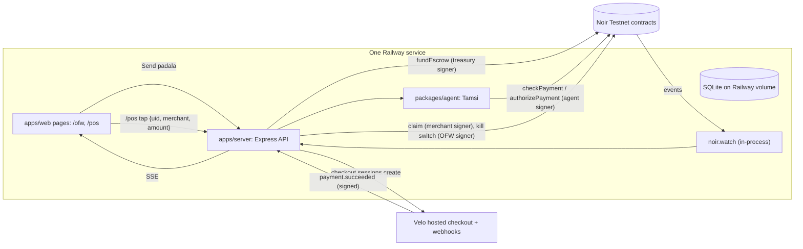

# Tamsi — System Design (solo build)

## 1. Architecture

One Railway service. Express serves the API **and** the built web app (`apps/web/dist`), so there is one URL and no CORS.



## 2. Keys and who signs what

| Key | Lives | Signs (all via Noir SDK) |
| :-- | :-- | :-- |
| OFW (device owner) | Server env (**demo only**; README says production uses the Noir extension) | registerDevice, `registerAgent` (in `setup.ts`), `revokeAgent`, `defundEscrow` (kill switch) |
| Treasury | Server env. Same wallet that owns the Velo project, so checkout money lands here | `fundEscrow` after a verified Velo payment |
| Agent | Server env only | `authorizePayment` |
| Demo merchants (3) | Server env | `claim` |

Card policy: `asset` = native XLM SAC (`Asset.native().contractId(Networks.TESTNET)`), `maxAmount` = per-tap max, `expiresAt` = +30 days. Once funded, the escrow is bound to XLM.

Who pays the Velo checkout in the demo: any browser wallet (the Noir extension works). In the story, that's the OFW sending padala.

## 3. Flows

### Setup (`pnpm setup:testnet`, one command, rerunnable)
1. Generate + Friendbot: OFW, agent, treasury (or reuse from env), 3 merchants.
2. `deviceHash = sha256(uidString)` for 1 demo card UID (match Noir's NFC hashing doc).
3. OFW signs registerDevice (owner = OFW, agent = AGENT public key). Confirm the exact method name from the SDK README; the handbook calls it `registerDevice`.
4. `noir.execute(ofw, { kind: 'registerAgent', deviceHash, agent, asset, maxAmount, expiresAt })`.
5. Seed DB: card, rules (daily cap, allowed categories, savings floor, next payday), merchants with categories.
6. Print a summary with Stellar Expert links.

### Top-up (Velo → Noir)
1. `POST /api/topups {deviceHash, amount}` → `velo.checkout.sessions.create({ amount, asset: 'native', description, successUrl, cancelUrl }, { idempotencyKey: topupId })`. Store `paymentIntentId → topup` (no metadata field; sessions expire in 30 min).
2. Payer pays on Velo's hosted page; money lands in the treasury.
3. `POST /webhooks/velo` (raw body): `Velo.webhooks.verify` → dedupe delivery id → `paymentIntents.retrieve(id)` is paid → `noir.execute(treasury, { kind: 'fundEscrow', deviceHash, token: asset, amount })` → topup `funded`, store tx hash.
4. `/pay/success` shows "waiting for ledger confirmation" until the topup is `funded`.

### Tap (the agent decides)
`POST /api/taps {uid | deviceHash, merchantId, amount}` → per-card serial queue → `tamsi.decide()`:

| # | Check | Fail → |
| :-- | :-- | :-- |
| 1 | Card known and `status = active` | `card_inactive` |
| 2 | Merchant category in the card's allowlist | `merchant_not_allowed` |
| 3 | `spentToday + amount <= dailyCap` (PH day, UTC+8) | `daily_cap` |
| 4 | `getEscrowBalance - amount >= iponFloor` | `ipon_floor` + top-up request |
| 5 | `noir.checkPayment({ deviceHash, agent, asset, amount })` | Noir's reason: `no_agent`, `wrong_agent`, `wrong_asset`, `invalid_amount`, `over_limit`, `expired`, `insufficient_escrow` |
| 6 | `noir.authorizePayment({ agent, deviceHash, merchant, asset, amount })` | `NoirContractError.errorName` |
| 7 | After paying: usable balance < 2 days of average spend → top-up request | — |

Deterministic code only. Each result has `reasonCode` + a template sentence.

**Top-up request amount** = `avgDailySpend(last 7 days, default dailyCap/2) × daysUntilNextPayday + iponFloor − escrowBalance`, rounded up to 1 XLM, minimum 5 XLM. The agent creates the Velo session itself (`requested_by = 'agent'`) and the feed shows the formula filled in.

### Events → feed
On boot: `noir.watch({ types: ['payment.authorized', 'payment.claimed', 'escrow.funded', 'escrow.defunded', 'agent.revoked'], onEvent })`, filtered to our device hashes and merchants; dedupe on `event.id`; save; push over SSE. Also backfill with `noir.getEvents({ startLedger })` from the last saved ledger.

### Claim
`/pos` has a "Collect payments" button per merchant: `getPendingBalance` → `claim({ merchant, token: asset })`. (Tier 3: run it on a 60 s timer.)

### Kill switch
`POST /api/cards/:hash/kill` → `noir.execute(ofw, { kind: 'revokeAgent', deviceHash })` → `noir.execute(ofw, { kind: 'defundEscrow', deviceHash, token: asset, amount: balance })` → card `revoked`. Never revoke the device while escrow > 0. `setup.ts` re-registers the agent for the next demo run.

## 4. Data model (SQLite)

| Table | Columns |
| :-- | :-- |
| `cards` | `device_hash` PK, `label`, `holder_name`, `owner_wallet`, `agent_pubkey`, `max_per_tap`, `expires_at`, `status` |
| `rules` | `device_hash` FK, `daily_cap`, `ipon_floor`, `allowed_categories` (JSON), `next_payday` |
| `merchants` | `id` PK, `name`, `category`, `stellar_address` |
| `taps` | `id` PK, `device_hash`, `merchant_id`, `amount`, `decision`, `reason_code`, `reason_text`, `nonce`, `tx_hash`, `created_at` |
| `topups` | `id` PK, `device_hash`, `payment_intent_id` UNIQUE, `amount`, `requested_by` (`ofw`/`agent`), `status`, `checkout_url`, `fund_tx_hash` |
| `noir_events` | `id` PK, `type`, `payload`, `ledger` |
| `velo_deliveries` | `delivery_id` PK |

Amounts are stroops stored as TEXT and read as `BigInt` (SQLite integers lose precision past 2^53 in JS drivers).

Categories: `grocery`, `sari_sari`, `pharmacy`, `school`, `utilities`, `other`. Demo merchants: one grocery, one pharmacy, one not allowed ("Games arcade").

## 5. API

| Method | Path | Notes |
| :-- | :-- | :-- |
| GET | `/api/merchants`, `/api/cards` | Lists for the `/pos` pickers |
| GET | `/api/cards/:hash` | Card, rules, balance, spent today |
| PATCH | `/api/cards/:hash/rules` | Edit off-chain rules (Tier 3 UI) |
| POST | `/api/cards/:hash/kill` | Kill switch |
| POST | `/api/taps` | Run the agent |
| POST | `/api/topups` | Create Velo checkout |
| POST | `/api/merchants/:id/claim` | Claim pending |
| GET | `/api/stream/:hash` | SSE: decisions, events, top-up requests |
| POST | `/webhooks/velo` | raw body |
| GET | `/api/health` | Agent + treasury XLM, watcher status |

## 6. Sitemap

| Page | Contents | Links to |
| :-- | :-- | :-- |
| `/` | One-line pitch, 3 steps, buttons | `/ofw`, `/pos` |
| `/ofw` | Left today, balance, savings kept; "Send padala"; live feed (approved + declined with reasons, Stellar Expert links); agent top-up requests with pay link; kill switch | Velo hosted page |
| `/pos` | Pick merchant, amount, "Tap card" (type/select UID; Web NFC on Android is Tier 3); big decision card; "Collect payments" | `/` |
| `/pay/success`, `/pay/cancel` | Velo return; success polls top-up status | `/ofw` |

Show a mocked peso figure next to XLM, labelled "Demo rate — Testnet XLM, no real money".

## 7. Environment variables

| Name | What | Where |
| :-- | :-- | :-- |
| `VELO_API_KEY` | Velo Testnet key | velo-build.dev dashboard |
| `VELO_WEBHOOK_SECRET` | Velo webhook signing secret | Velo dashboard |
| `TREASURY_SECRET` | Secret of the Velo project's owner wallet | Generated by you; imported into a wallet to create the Velo project |
| `OFW_SECRET` | Demo device owner | `setup.ts` |
| `AGENT_SECRET` | Tamsi agent key | `setup.ts` |
| `MERCHANT_SECRETS` | JSON `{id: secret}` | `setup.ts` |
| `DEMO_CARD_UID` | Card UID string | Any, or a real tag |
| `SQLITE_PATH` | DB file on the Railway volume | e.g. `/data/tamsi.db` |
| `PUBLIC_URL` | Live URL, used for Velo success/cancel URLs | Railway |
| `DEMO_PHP_PER_XLM` | Mock display rate | Choose |

No contract IDs: the SDK's built-in `TESTNET` already points at the Oct 24 deploy.

## 8. Repo layout (monorepo is required)

```
tamsi/
├── apps/web/         Vite + React; built to dist/, served by the server
├── apps/server/      Express: API, Velo webhook, SSE, noir.watch
├── packages/agent/   Tamsi pipeline + Noir SDK calls
├── packages/shared/  Types, reason codes, stroops helpers, categories
├── scripts/          setup.ts, spike.ts
├── docs/             Plan files, testnet-proof.md, screenshots
├── .env.example
├── package.json      pnpm workspaces; `pnpm build` builds web then server
└── README.md
```
